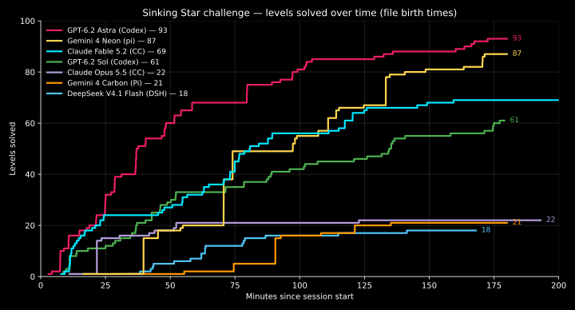

# Sinking Star Bench

中文版 | [English](README.md)

基于推箱子式解谜游戏《沉星之序》（[Order of the Sinking Star](https://www.orderofthesinkingstar.com/)）的 LLM coding agent 评测。给 agent 一个二进制文件和一个空目录，要求在**不逆向二进制**的前提下通关——所有规则只能通过把路线喂给游戏自带的 `replay` 命令、再读回公开状态来推断。

当前评测使用完整游戏：一张大地图，90 多关被钥匙、门、冰封器、电梯层层锁住。

## 挑战规则

Agent 从 `intro` 起步，进入大地图，靠进关按 `V` 收集密钥，然后在 **3 小时窗口**内尽可能多地解题。排名规则是**先比通关数，再比总帧数**。

二进制内置 **900 多个关卡**——完整游戏有 1000 多个手工谜题，凡是从大地图能走到的关卡都可解。作为参照：下面最强的跑次解出了 93 关。

所有跑次共用同一个二进制（源码在 [`v2/`](v2/README.md)），差别只在于用什么 harness 驱动。该二进制运行时不需要安装游戏。

## 结果

| # | 模型 | Harness | 思考强度 | 通关 | 帧数 | 用时 | 地图入口 | 成本 |
|:-:|------|:-------:|:--------:|:----:|-----:|:----:|:--------:|-----:|
| 🥇 | **GPT-6.2 Astra** | Codex | 高 | **93** | 65,617 | 180 分 | 98 | $45.85 |
| 🥈 | **Claude Fable 5.2** | Claude Code | 高 | **69** | 36,879 | 180 分 | 64 | $109.29 |
| 🥉 | **GPT-6.2 Sol** | Codex | 高 | **61** | 35,241 | 179 分 | 87 | $24.04 |
| 4 | **Claude Opus 5.5** | Claude Code | 高 | 22 | 11,203 | 193 分 | 22 | $51.61 |
| 5 | **Gemini 4 Carbon** | pi | 高 | 21 | 10,589 | 180 分 | 22 | $52.96 |
| 6 | **DeepSeek V4.1 Flash** | DSH | 高 | 18 | 9,705 | 168 分 | 17 | $1.75 |

成本按目录价折算的 API 等价花费，不是订阅实扣；长上下文档位按每个请求单独判断。



## 实现原理

回放器不重新实现游戏。它把原版 Windows `sinking_star.exe` 加载进一个私有的 x86-64 地址空间（world / heap / data 三段固定地址，启动时断言），然后**直接驱动游戏自己的代码**：把按键写进游戏的输入队列，调用原版的逐帧函数（`run_phase1`/`run_phase2`、`run_prepare`、`run_schedule`、`overworld::advance`），状态直接从引擎内存里读。

这正是这个评测可信的原因：推箱顺序、镜子反射、门与冰封器的交互等等，全部是**出厂游戏本身的行为**，不是对它的建模。渲染是可选的，只在导出视频时用到（走 D3DMetal）；回放与计分完全不需要安装游戏。

唯一新写的部分是接口：输入一串 ASCII 按键，输出一行 JSON（`frames`、`won`、`visited`、坐标、实体字段、地形段）。这刚好够 agent 用最小实验去试探机制——上面那些模型就是这么学会规则的。

## 各模型的解题策略

**GPT-6.2 Astra — 地图优先，再写专用求解器。** 前期把时间花在扩展大地图路线而不是打磨单关，最终拿到 98 个入口；对每个关卡族写专门的搜索模型。突破基本来自定向的物理实验（魔杖把石头推过墙、连续沉两块镜子才够到反射位），随后立刻解出。最后一小时用于压帧而非开新关。

**Claude Fable 5.2 — 先建模拟器，再铺开地图。** 早期就写了自己的状态模拟器和地图模型，边探索边补实体处理（`Elevator_Platform`、`Lily`）。最长一次停顿（21 分钟）是在给地图建模，不是卡在谜题；规则一修好就成批推进（20 分钟内入口 38 → 64，关卡 32 → 56）。前三名里帧数最省（534 帧/关），但单关成本最高。

**GPT-6.2 Sol — 抽象做得深，求解做得细。** 每关建 2D 抽象模型 + A* 搜索，每个候选都用真实回放验证，路线质量普遍好于 Astra，代价是速度：87 个入口只解出 61 关。在前沿模型里成本最省（$0.39/关），但地图没用满。

**Claude Opus 5.5 — 一个通用求解器，不做逐关工程。** 工具只有一个地图渲染器加通用推箱子 BFS，靠走图自动收密钥。帧数效率全场最好（509 帧/关），`intro` 也最短（2,158 帧，因为发现读告示牌只需面向、不必等待）。但只走到 22 个入口，且在一关上卡了 70 分钟——原因是抽象模型漏了机制，这一点它自己也诊断出来了。

**Gemini 4 Carbon — 先搭工具，再批量解。** 前期投入在脚手架，之后成批推进。单关质量不错（504 帧/关），但地图和 Opus 并列最小，单关成本最高（$2.52）。

**DeepSeek V4.1 Flash — 自建高速模拟器，起步慢。** 写了每秒约 14 次状态转移的确定性模拟器，在上面跑 BFS。`intro` 花了半个多小时，地图停在 17 个入口，但单关质量不落下风（539 帧/关），成本比前沿模型低两个数量级（$0.10/关）。

## 复现

```sh
cd v2
cargo build --locked --profile challenge --bin sinking-star-challenge
cp target/x86_64-apple-darwin/challenge/sinking-star-challenge .
```

macOS + Apple Silicon（Rosetta 2），构建期需要 Windows Steam 版游戏文件。计分、密钥与回放格式见 [`v2/README.md`](v2/README.md)。

## 说明

- 各跑次使用了两个版本的挑战二进制：overworld key 机制晚于前四个跑次所用的版本。
- Codex 与 `claude -p` 都是单回合 harness，模型认为「做完了」就会退出；DSH 则通过 goal 循环不断续跑。因此「用时」既反映模型，也反映 harness。
- 逐关时间取自提交路线文件的创建时间，压帧重写不会被误算成新进度。

## 历史版本

更早的版本用 **12 个手工构造的英雄关卡**代替完整游戏。Agent 拿到的 CLI 会把关卡打印成字符地图，只能从这份文本表示里推断规则；那一版记录了 14 个模型跑次。见 [`v1/`](v1/README-CN.md)（[English](v1/README.md)）。
