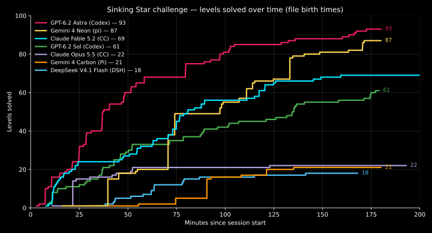

# Sinking Star Bench

[中文版](README-CN.md) | English

An LLM coding-agent benchmark built on *[Order of the Sinking Star](https://www.orderofthesinkingstar.com/)*, a sokoban-style puzzle game. The agent gets one binary and an empty directory and must beat it **without reverse-engineering the binary** — every rule has to be inferred from the public state returned by the command-line game engine.

Agents start from `intro`, break into the overworld, collect level keys by entering each level and pressing `V`, then solve as many levels as they can within a **3-hour window**. Ranking is **levels solved first, total frames second**. The binary ships with **900+ levels** — the full game has more than 1,000 hand-crafted puzzles, and every level reachable from the overworld is playable.

All runs use the same binary, built from the sources in [`v2/`](v2/README.md) (a prebuilt `sinking-star-challenge` is committed there via Git LFS); only the harness differs. The binary is self-contained at runtime — no game install needed.

## Results

| # | Model | Harness | Thinking | Solved | Frames | Time | Map entries | Cost |
|:-:|-------|:-------:|:--------:|:------:|-------:|:----:|:-----------:|-----:|
| 🥇 | **GPT-6.2 Astra** | Codex | High | **93** | 65,617 | 180 min | 98 | $45.85 |
| 🥈 | **Gemini 4 Neon** | pi | High | **87** | 52,523 | 180 min | 96 | $41.42 |
| 🥉 | **Claude Fable 5.2** | Claude Code | High | **69** | 36,879 | 180 min | 76 | $109.29 |
| 4 | **GPT-6.2 Sol** | Codex | High | 61 | 35,241 | 179 min | 87 | $24.04 |
| 5 | **Claude Opus 5.5** | Claude Code | High | 22 | 11,203 | 193 min | 22 | $51.61 |
| 6 | **Gemini 4 Carbon** | pi | High | 21 | 10,589 | 180 min | 22 | $52.96 |
| 7 | **DeepSeek V4.1 Flash** | DSH | High | 18 | 9,705 | 168 min | 17 | $1.75 |



Reference solutions for every level are in [`v2/solutions/std`](v2/solutions/std); what each run actually submitted is kept alongside in `v2/solutions/<run>` (`astra62`, `neon`, `fable52`, `sol62`, `opus55`, `carbon`, `v41f`).

## How it works

The replay tool does not reimplement the game. It loads the original Windows `sinking_star.exe` into a private x86-64 address space (fixed segments for world, heap and data, asserted at startup), and drives the **game's own code**: it writes keystrokes into the game's input queue, calls the original per-frame functions (`run_phase1`/`run_phase2`, `run_prepare`, `run_schedule`, `overworld::advance`), and reads state straight out of the engine's memory.

That is what makes the benchmark trustworthy: every rule — push order, mirror reflection, gate and freezer interactions — is whatever the shipped game does, not a model of it. Rendering is optional and only used for video export (through D3DMetal); replay and scoring need no game install.

The only thing that is new is the interface: an ASCII key string in, and one JSON line out (`frames`, `won`, `visited`, position, per-entity fields, terrain runs). That is enough for an agent to probe mechanics with tiny experiments, which is exactly how the models in the table above learned the rules.

## How each model approached it

**GPT-6.2 Astra — map first, then bespoke solvers.** It spent the early hours extending the overworld route rather than polishing levels, ending with 98 entries, and wrote a dedicated search model per level family. Most of its breakthroughs came from targeted physics experiments (pushing a rock through a wall with the wand, sinking two mirrors to reach a reflection cell) followed by immediate solves. Its final hour went into frame compression rather than new levels.

**Gemini 4 Neon — fast C++ solvers per family, map and levels in lockstep.** It wrote a small Python toolkit (level inspector, ASCII renderer, an overworld model with BFS pathing) and then compiled one C++ BFS solver per level family — Heroes 1/2/3 and two for Mirrors — feeding each the terrain and entities read from `state`, and checking every candidate with a real replay. It cleared `intro` in 16 minutes and then extended the map and solved new levels alternately rather than in phases: 18 levels by minute 54, 48 by minute 97, 79 by minute 148 (not counting `intro`), with 96 map entries at the end. Per-level quality (604 frames/level) trails the top runs, but it is the cheapest run in the top three per level ($0.48/level). It worked through the whole window in a single uninterrupted pi turn.

**Claude Fable 5.2 — build the simulator, then widen the map.** It wrote its own state simulator and overworld model early, then kept patching entity handling (`Elevator_Platform`, `Lily`) as it explored. Its longest stall (21 minutes) was map modelling, not puzzle solving; once a rule was fixed, levels fell in batches (38 → 76 entries over the run, 32 → 56 levels in 20 minutes). Best frame efficiency among the top three (534 frames/level) and the most expensive run per level.

**GPT-6.2 Sol — abstract hard, solve carefully.** It built 2D abstractions and A* search per level, validated each candidate against the real replay, and generally produced cleaner routes than Astra at the cost of speed: with 87 entries it still only solved 61 levels. The most cost-efficient of the frontier runs ($0.39/level), but it under-used its map.

**Claude Opus 5.5 — one generic solver, no per-level engineering.** Its toolkit was just map rendering plus a plain Sokoban BFS; it auto-collected keys by walking the map. That produced the best frames-per-level in the field (509) and the shortest `intro` (2,158 frames, by noticing signs only need to be faced, not waited on), but it only reached 22 map entries and spent 70 minutes blocked on one level because its abstract model was missing a mechanic — a limitation it diagnosed itself.

**Gemini 4 Carbon — tools first, batch second.** It invested in scaffolding before touching levels, then solved in batches. Solid per-level quality (504 frames/level) but the smallest map alongside Opus, and the most expensive per level ($2.52).

**DeepSeek V4.1 Flash — custom fast simulator, slow start.** It built a deterministic simulator running ~14 state transitions per second and ran BFS on top of it. The intro cost it over half an hour and the map stayed at 17 entries, but per-level quality was competitive (539) and the run was two orders of magnitude cheaper than the frontier models ($0.10/level).

## Reproducing

```sh
cd v2
cargo build --locked --profile challenge --bin sinking-star-challenge
cp target/x86_64-apple-darwin/challenge/sinking-star-challenge .
```

macOS on Apple Silicon (Rosetta 2); the Windows Steam build of the game is required at build time only. Scoring, key handling and replay format are documented in [`v2/README.md`](v2/README.md).

## Notes

- Runs used two builds of the challenge binary: the overworld key mechanism is newer than the build used by the first four runs.
- Codex and `claude -p` are single-turn harnesses that stop when the model decides it is done; DSH was driven by a goal loop. Time used reflects harness behaviour as much as model behaviour.
- The Gemini 4 Neon run used pi 1.6.1 against Vertex AI (`google-vertex/gemini-4-neon:high`) with extensions, skills and context files disabled. The wrapper would have resumed the session with `--continue` if pi exited early, but Neon never exited, so the run is a single pi turn.
- Per-level timestamps come from file creation times, so frame rewrites are not counted as new progress.

## Previous versions

An earlier build of this benchmark used **12 hand-crafted hero levels** instead of the full game. Agents were given a CLI that printed each level as a character map, and had to infer the rules from that text representation alone; 14 model runs are recorded there. See [`v1/`](v1/README.md) ([中文](v1/README-CN.md)).
